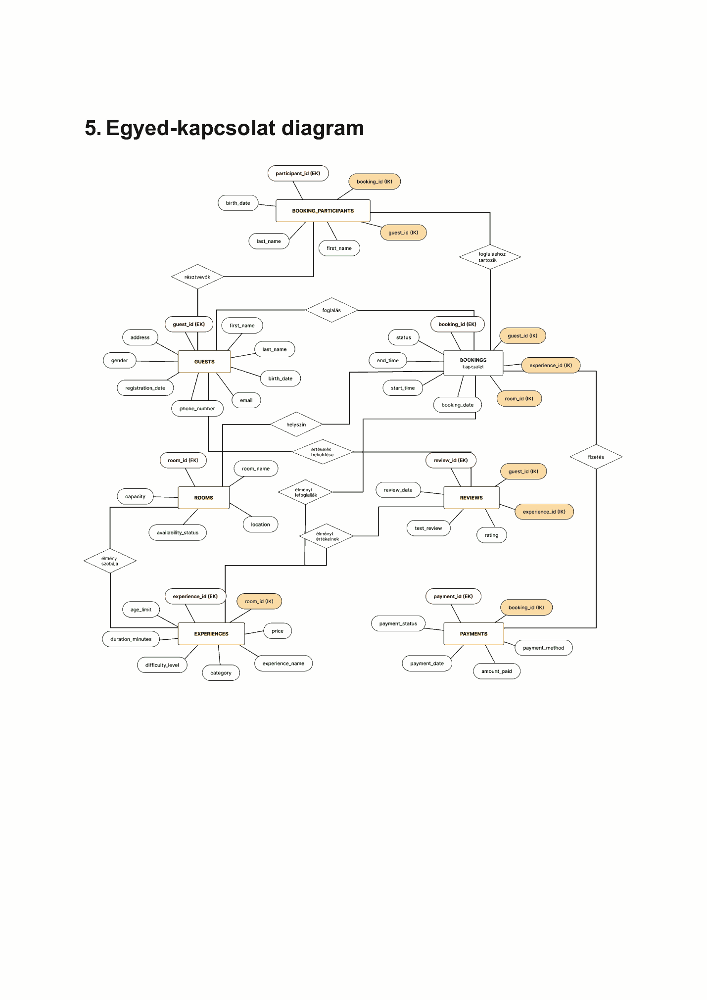

# VR Élménypark – relációs adatbázis / SQL portfólió

**Egyetemi alapmunka:** 2025–2026 · **Adatbázis-kezelő:** Microsoft SQL Server
(T-SQL, SQL Server 2022 Express a forrásban) · **Portfólió demó:** Python 3 + SQLite.

Egy VR-élménypark foglalásait, élményeit, szobáit, vendégeit, fizetéseit és
értékeléseit modellező egyetemi projekt. A dokumentált eredeti munka
**13 táblás relációs adatmodellből, 17 SQL-lekérdezésből és 1 tárolt
eljárásból** áll.

A jelen repository-csomag ezekből 2026 novemberében készített, elkülönített,
**utólagos, AI-támogatással létrehozott, hordozható demonstráció**.
Az eredeti SQL-tervezés és beadandó a hallgató saját munkája;
a külön SQLite/T-SQL portfóliókódot nem mutatjuk be korabeli önálló
implementációként. Nem állítja, hogy az eredeti SQL Server
adatbázist változatlanul futtatja vagy hogy webalkalmazás is elkészült.

## Eredeti ER-diagram



## Képességek
- 7 fő entitás: GUESTS, BOOKINGS, BOOKING_PARTICIPANTS, EXPERIENCES,
  ROOMS, PAYMENTS, REVIEWS; 6 segédtábla.
- JOIN, LEFT JOIN, GROUP BY, SUM/AVG/COUNT, csoportosított elemzések,
  rendezés, CASE, allekérdezés, paraméteres lekérdezés.
- Idegen és elsődleges kulcsok, egyediség és egyes CHECK-korlátok.
- Kitalált tesztadatok, amelyekben aktív, lemondott és teljesített foglalások;
  sikeres, függő és sikertelen fizetések különülnek el.
- Helyben generált, önálló HTML/JSON/CSV jelentés.

## Kipróbálás (kizárólag helyi, hálózat nélkül)

```bash
python3 run_demo.py
python3 -m unittest discover -s tests -v
```

A demó SQLite-in-memory adatbázist épít, lefuttatja a 17 SELECT-et és az
eljárás logikájának paraméterezett SQLite-megfelelőjét, majd a
`demo_output/report.html` fájlba ír egy megnyitható riportot. Az SQL-fájlokat
nem kell szerverre telepíteni. Python 3 standard library elegendő.

## Bizonyíték és határok
A `docs/SOURCE_EVIDENCE.md` tartalmazza az eredeti PDF-ek lenyomatait és a
forrásszintű tényeket. A `docs/CHANGES.md` feltünteti az eredeti munka és
az utólagos portfólió-adaptáció közötti **lényegi eltéréseket**.

**Fontos:** az eredeti SQL-dokumentációban a sikeres, függő és sikertelen
fizetések aggregálása helyenként nem különült el. A demó ennek üzleti
következményét szemlélteti. A fiktív bevételi riport nem valós könyvelési adat.

## SQL Server-futtatás (választható, még nincs natívan verifikálva)

A `sql/sqlserver/` mappa az eredeti T-SQL projektből **újraalkotott**, nem szó
szerint másolt séma- és lekérdezésváltozatot tartalmaz. Nem az eredeti
`VRElmenypark` adatbázisra telepítendő: a fájlok kizárólag az új, üres
`VRElmenyparkPortfolio` helyi tesztadatbázison engedik a műveleteket.

SQL Server Management Studio-ban vagy `sqlcmd`-del, **kizárólag elkülönített
helyi példányon**:

```sql
CREATE DATABASE VRElmenyparkPortfolio;
```

Az **elkülönített adatbázisra való átváltás és annak ellenőrzése után**
(`SELECT DB_NAME()` → `VRElmenyparkPortfolio`) a következő fájlok
futtathatók sorrendben. A T-SQL portfóliószkriptek az adatbázis nevét egyetlen
batch-en belül ellenőrzik, így egy első `THROW` után nem maradnak futtatható
későbbi `GO` szakaszok. Ez statikus biztonsági ellenőrzés, nem natív runtime-teszt.

1. `sql/sqlserver/01_schema.sql` (13 tábla)
2. `sql/sqlserver/02_synthetic_seed.sql` (kizárólag fiktív adatok)
3. `sql/sqlserver/03_queries.sql` (17 jelentés)
4. `sql/sqlserver/04_stored_procedure_portfolio.sql` (paraméteres eljárás)

**Ez az útvonal NEM volt SQL Serveren végigtesztelve**, mivel nem állt
rendelkezésre SQL Server példány. A SQL Server-szkriptekben az elszigetelt adatbázisnév ellenőrzése a
módosító SQL-lel azonos batch-ben marad. Ettől még a valódi SQL Server
szintaktikai és futásidejű kompatibilitás **UNKNOWN**.

A `demo_output/VERIFICATION.json` a
SQLite útvonal bizonyítéka, nem helyettesíti az SQL Server natív futását.

**Portfólió-státusz: forrásazonosított, felülvizsgált demonstráció.**
A repository az eredeti egyetemi projekt utólagos, elkülönített változatát mutatja be;
az eredeti beadandó teljes PDF-je és személyes adatnak tűnő eredeti minta
nem része a publikálható állománynak.
